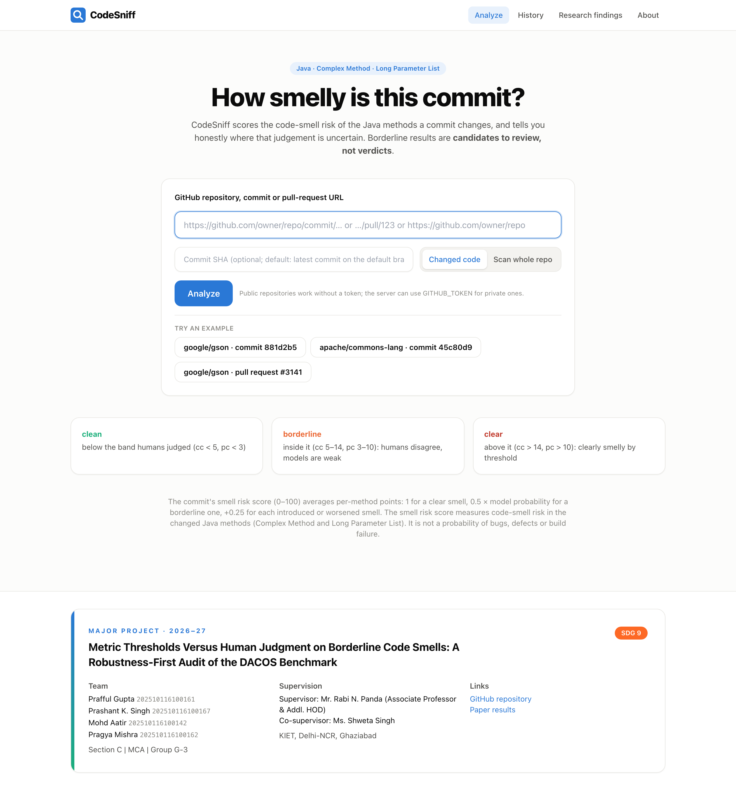
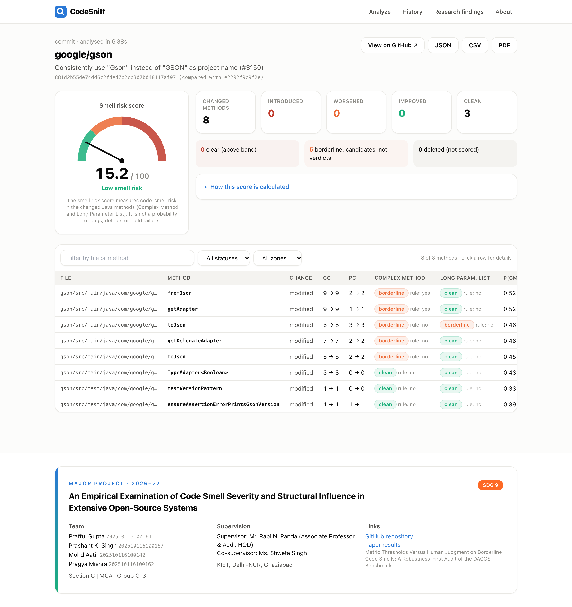
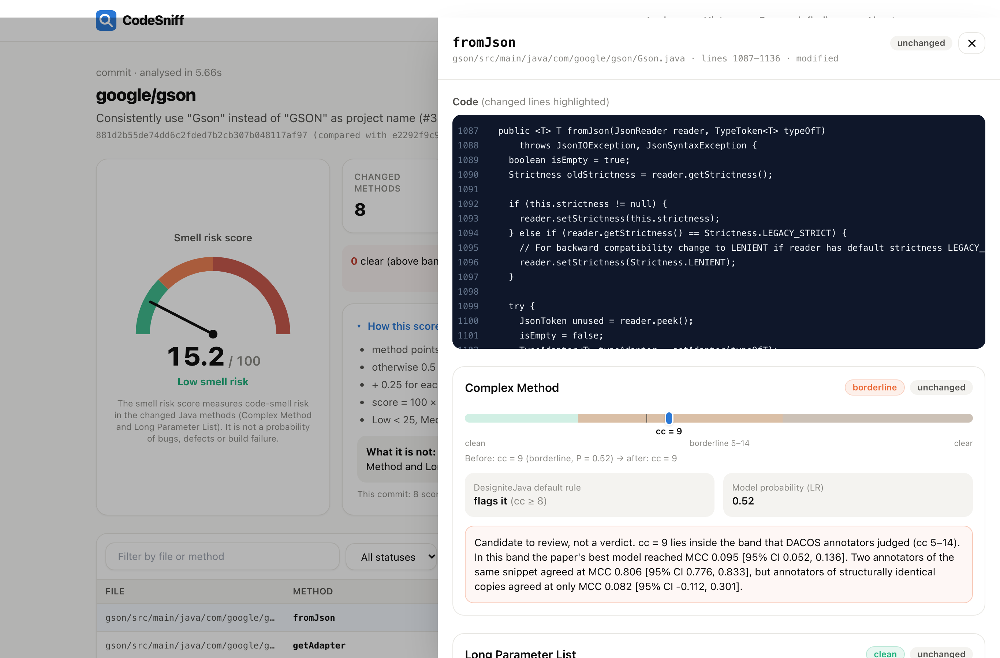
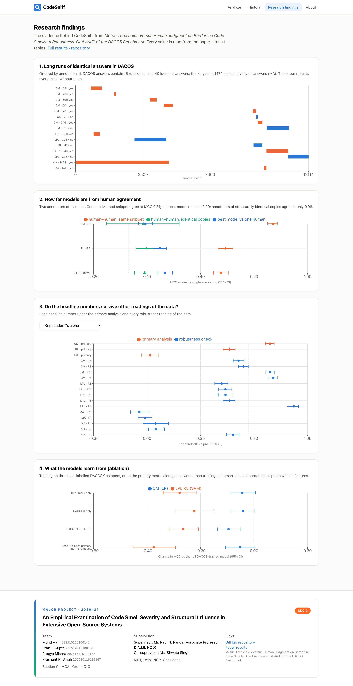
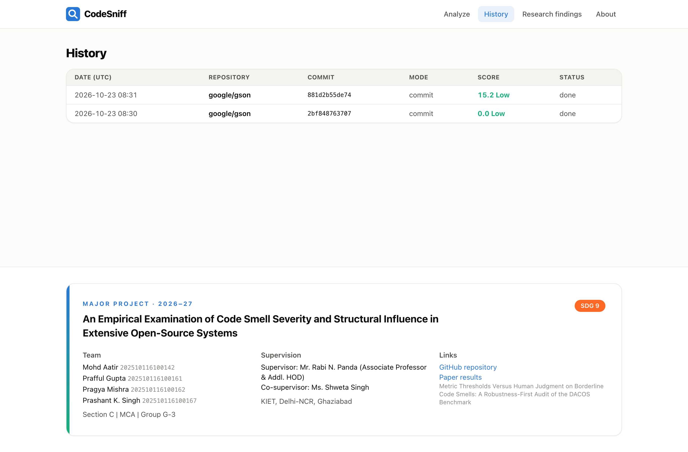
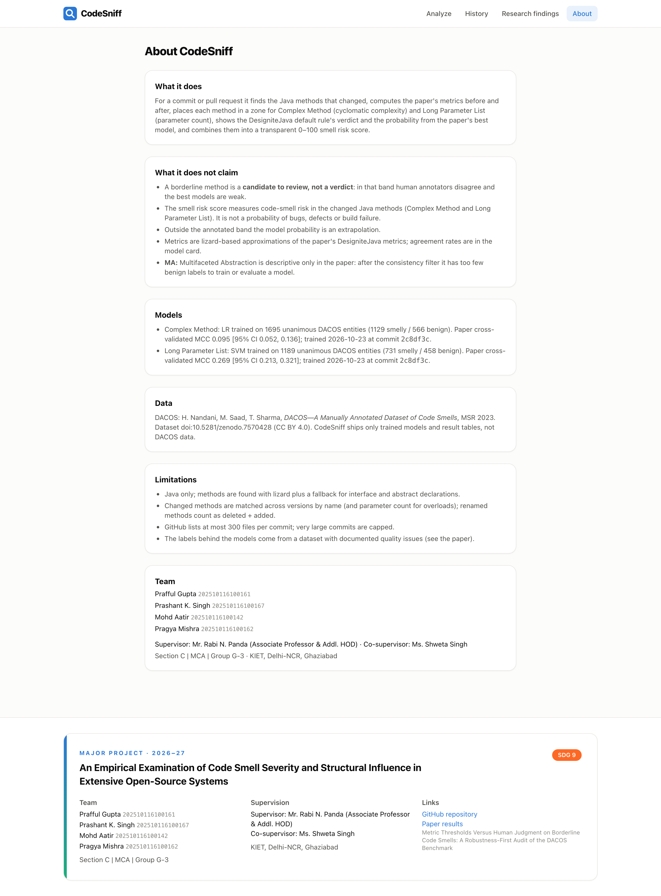
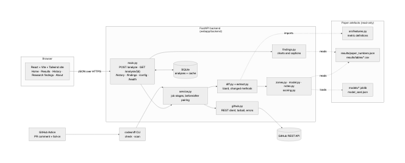

# CodeSniff

CodeSniff scores the **code-smell risk of a Java commit**. Paste a GitHub commit, pull request or repository and it:

- finds the methods the change adds, modifies or deletes;
- measures them before and after the change;
- places each method in one of the paper's zones for **Complex Method** (cc) and **Long Parameter List** (pc);
- combines the results into a 0–100 smell risk score.

The score measures code-smell risk in the changed methods. **It is not a probability of bugs, defects or build failure.** Borderline results are candidates to review, not verdicts.

CodeSniff is the companion tool of *Metric Thresholds Versus Human Judgment on Borderline Code Smells: A Robustness-First Audit of the DACOS Benchmark* (repository root). Every number the site shows comes from one of three places, and none is typed by hand:

- [`results/paper_numbers.json`](../results/paper_numbers.json) and `results/tables/*.csv`;
- the model card, [`backend/models/model_card.json`](backend/models/model_card.json);
- live computation.

| Home | Results (gson commit 881d2b5, analysed end to end) |
|---|---|
|  |  |
| **Method drawer** | **Research findings** |
|  |  |
| **History** | **About** |
|  |  |

The progress view ([2_progress.png](docs/screenshots/2_progress.png)) and the mobile layout ([8_home_mobile.png](docs/screenshots/8_home_mobile.png)) are also in `docs/screenshots/`. Recapture them all with `python scripts/screenshots.py` while `make dev` is running.

## Run it locally

You need Python 3.9–3.11 and Node 20 or later.

```bash
cd webapp
make install          # creates .venv (backend) and installs the npm packages (frontend)
make dev              # API on http://localhost:8000 (docs at /docs), site on http://localhost:5173
```

With Docker installed, run this from the repository root instead:

```bash
docker compose up --build
```

**Optional settings:**

- `export GITHUB_TOKEN=…` before starting. This raises the GitHub limit from 60 to 5,000 requests per hour and lets the server read private repositories that the token can access.
- `CODESNIFF_DB`: where the SQLite history is stored.
- `CODESNIFF_CORS`: the allowed site origins.
- `CODESNIFF_MAX_CHANGED_FILES` (default 150) and `CODESNIFF_SCAN_FILES` (default 300): file caps.

The site **does not need the DACOS raw data**. The models are pre-trained, and the findings are read from the committed result tables. Only `backend/train_models.py`, which refits the models, needs the data downloaded by `run_all.sh`.

## Architecture



| Part | Where | What |
|---|---|---|
| Website | `frontend/` | React 18, Vite, Tailwind and Recharts. Pages: Home, Results, History, Research findings, About. A project card in the footer of every page. |
| API | `backend/main.py` | FastAPI. Endpoints: `POST /analyze` (returns 202 with an id; the job runs in the background), `GET /analysis/{id}`, `GET /analysis/{id}/report.{json,csv,pdf}`, `/history`, `/findings`, `/config`, `/health`. |
| Analysis | `backend/codesniff/` | `github.py` (REST client and errors), `diff.py` and `extract.py` (lizard, changed methods), `zones.py`, `model.py`, `notes.py`, `scoring.py`, `service.py`, `store.py` (SQLite, with a cache keyed by repository and full SHA). |
| CLI | `backend/cli.py` | `codesniff check` and `codesniff scan`. |
| GitHub Action | [`../action.yml`](../action.yml) | Posts the score and table as a PR comment and fails at the configured band. |

Data flow and sequence: [data-flow](docs/diagrams/data-flow.png) and [sequence](docs/diagrams/sequence.png). The Mermaid sources sit next to the rendered files in `docs/diagrams/`.

### Metrics, zones and models

- **Metrics** are those of the paper's [`src/features.py`](../src/features.py), which CodeSniff imports unchanged.
  - **cc** is lizard's cyclomatic complexity minus the number of `&&` and `||`, to match DesigniteJava. On 200 DACOS snippets it agrees exactly with DesigniteJava 83.5% of the time, against 63.5% for raw lizard; pc agrees 93% of the time ([`lizard_agreement.json`](backend/models/lizard_agreement.json)).
- **Zones** come from the paper's threshold bands (`results/tables/audit_threshold_ranges.csv`):
  - clean: below the band;
  - borderline: inside the band, where humans disagree and models are weak;
  - clear: above the band.
- **The DesigniteJava verdict** (cc ≥ 8, pc ≥ 5) is shown next to each zone.
- **Models**, refitted on the paper's primary DACOS set with the most frequent hyperparameters from its nested cross-validation:
  - CM: logistic regression (C = 0.01), 1,695 entities;
  - LPL: the RBF SVM from the R5 analysis (C = 0.1, γ = 0.01, Platt-scaled), 1,189 entities, with the pc = 3 block removed.
  - Their cross-validated MCCs are low (CM 0.10, LPL 0.27). The site says so next to every borderline probability. See [`MODEL_CARD.md`](backend/models/MODEL_CARD.md).

### Smell risk score

For each changed method that still exists after the change:

```
method points = 1.0                               if any smell is clear
              = 0.5 × model probability           if borderline (highest among borderline smells)
              = 0                                 if all smells are clean
              + 0.25 for each introduced or worsened smell, capped at 1.0 per method
score = 100 × (sum of method points) / (number of changed methods)
Low < 25 ≤ Medium ≤ 50 < High;  small-sample flag when fewer than 3 methods changed
```

Each smell also gets a change status:

- **introduced:** it was clean before (or the method is new) and is now borderline or clear;
- **worsened:** its zone went up, or it is still borderline and the model probability rose by at least 0.2;
- **improved:** the reverse;
- **unchanged:** none of the above.

Deleted methods are listed but not scored. The parameters live in `backend/codesniff/scoring.py` (`RISK`). The site reads them from `/config`, and the Results page shows the formula next to the score.

## CLI and GitHub Action

```bash
python backend/cli.py check --repo https://github.com/google/gson --sha 881d2b55de74 --format markdown
python backend/cli.py check --pr https://github.com/google/gson/pull/3141 --fail-on medium
python backend/cli.py scan path/to/src --format sarif -o codesniff.sarif
```

- `--fail-on high|medium|never` sets the band that makes the command exit with code 1. Exit code 2 means an input or GitHub error.
- To use the action in another repository:

  ```yaml
  - uses: Prafful7601/beyond-thresholds-code-smells@<tag>
    with: { fail-on: high }   # needs permissions: pull-requests: write
  ```

  See [`.github/workflows/codesniff-example.yml`](../.github/workflows/codesniff-example.yml).

## Tests

```bash
make test             # backend pytest with coverage, then frontend Vitest with coverage
make e2e              # Playwright: the whole flow against a mocked backend
```

| Suite | Result | Coverage |
|---|---|---|
| Backend: extraction, changed-method detection, metrics, zones, risk formula, API endpoints, GitHub error mocks (`respx`), CLI and SARIF | 86 passed (the DesigniteJava agreement check skips when the DACOS data is absent, as in CI) | 90% of lines |
| Frontend unit and page tests (Vitest, Testing Library) | 18 passed | 92.7% of lines |
| End to end (Playwright, Chrome) | 2 passed | n/a |

CI ([`.github/workflows/webapp-ci.yml`](../.github/workflows/webapp-ci.yml)) runs all three on push and pull request and uploads the coverage reports.

## Deploy

Neither the API nor the site needs the DACOS data.

### Option A: one Vercel project (services)

The root [`vercel.json`](../vercel.json) defines two services on one domain:

| Service | Root | Public path |
|---|---|---|
| `backend` (FastAPI, `main.py`) | `webapp/backend` | `/api/*` |
| `frontend` (Vite) | `webapp/frontend` | everything else |

How the pieces fit:

- The site calls the API on its own domain at `/api`; that is the default when `VITE_API_URL` is unset in a production build. No service calls another server-side, so there are no bindings.
- The API answers its routes both with and without the `/api` prefix.
- A service only sees its own folder. The backend therefore reads a bundled copy of the paper files it needs, in `webapp/backend/paper/`. Refresh the copy with `python webapp/backend/sync_paper_files.py` after regenerating results; a test fails if the copy and the source differ.
- On Vercel (`VERCEL` is set) `POST /api/analyze` runs the analysis inside the request and returns the finished result, and the site shows it without polling. History and report downloads use SQLite in `/tmp`, which is per instance and temporary.

Steps:

1. Import the repository into Vercel with the Root Directory left at the repository root.
2. Optionally set `GITHUB_TOKEN` in the project's environment variables.
3. Deploy, then test locally with `vercel dev`.

### Option B: API on Render, site on Vercel

1. **API on Render:**
   - Create a new Blueprint from this repository; [`render.yaml`](../render.yaml) builds `webapp/backend/Dockerfile` from the repository root.
   - In the dashboard, set `GITHUB_TOKEN` (optional) and `CODESNIFF_CORS` (the site's URL).
   - On the free plan the SQLite history is lost on each redeploy.
   - **Any Docker host works instead:** `docker build -f webapp/backend/Dockerfile -t codesniff-api .`, then run it with `-p 8000:8000`.
2. **Site on Vercel:**
   - Import the repository with **Root Directory** set to `webapp/frontend`. [`vercel.json`](frontend/vercel.json) sets the Vite build and the SPA rewrites.
   - Add the environment variable `VITE_API_URL=https://<your-api>.onrender.com` (without it the site calls `/api` on its own domain).
   - Deploy.
3. **Check:**
   - `https://<your-api>/health` lists both models.
   - The site's Research findings page loads its charts from the API.

## Limitations

- **Two smells only, Java only.** Multifaceted Abstraction is not scored, because annotators barely agreed on it in DACOS (see About).
- **Borderline is uncertain by design.** Even two annotators of the same snippet do not agree perfectly. The models' cross-validated MCC is 0.10 (CM) and 0.27 (LPL). A borderline probability is a ranking hint, not a verdict.
- **The score is not a bug predictor.** It summarises smell zones and their changes. It has not been validated against defects, reviews or build outcomes.
- **Metric approximation.** The metrics come from lizard, not DesigniteJava. cc agrees exactly 83.5% of the time and is within 1 for 93% (see above).
- **Method matching.** Methods are paired by name, and by name plus parameter count for overloads. A renamed method appears as deleted plus added. Changes outside method bodies (fields, imports) are ignored.
- **GitHub limits:**
  - 60 requests per hour without a token;
  - at most 300 files listed per commit, and at most 150 changed Java files analysed by default;
  - a repository scan reads at most 300 Java files by default, from a tarball;
  - private repositories need a token.
- **Not verified here:**
  - Docker was not available on the development machine. The images were not built, but the image layout was tested by running the API from a copy of exactly the files the Dockerfile copies.
  - The GitHub workflows and the Action have not run on GitHub yet. The Action's scoring step was run locally against google/gson#3141.
